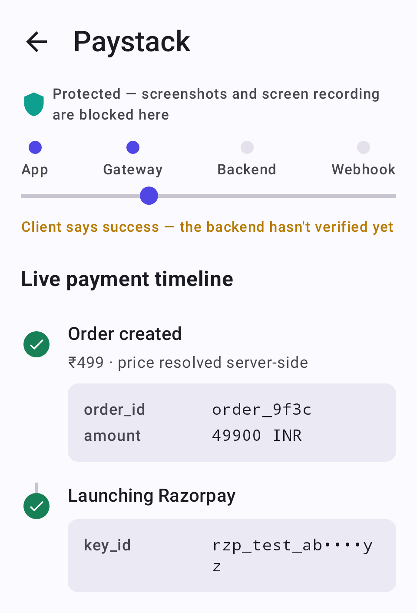

# PaymentsLab-KMP

A Kotlin Multiplatform app that runs payment flows through one `PaymentGateway` interface, with 70 gateways behind it and a small Ktor backend that does the parts a client cannot be trusted with. Each payment is drawn as a live timeline (order created, SDK launched, client result, server verification, settled) with the redacted payload at every step.

<!-- AUTOGEN:versions -->


<!-- /AUTOGEN:versions -->
<!-- AUTOGEN:badge -->

<!-- /AUTOGEN:badge -->

<!-- AUTOGEN:stats -->
> **At a glance**, **48-module** KMP architecture: **17 local** (9 core · 4 feature · 4 app/iOS/backend) + **31 composed** via `includeBuild(external/kmp-toolkit)` (12 shared core · 19 payment-provider gateways), **28** deterministic Roborazzi screenshots. *Numbers auto-generated from `settings.gradle.kts` by `scripts/gen-readme.sh`.*
<!-- /AUTOGEN:stats -->

## Why it exists

Payments is the part of Android integration where the client lies the most. Every gateway ships its own SDK, most of them still hand results back through Activity callbacks, and a `Success` on the phone proves nothing until a server has checked a signature. I wanted a project where that gap is the subject, not a checkout screen with a logo on it.

The rule the whole design follows: **a client-side `Success` is a hint, never proof.** The backend creates the order and owns the price, verifies the HMAC signature, and reconciles webhooks. The app writes a pending row to Room before the SDK launches, so a process death in the middle of a payment can be recovered, and it only trusts a result after the server confirms it.



## Getting it running

Clone with submodules. `kmp-toolkit` (which holds the shared libraries and 19 provider modules) and `kmp-build-logic` sit under `external/` and are pulled in with `includeBuild`, so an ordinary clone will not configure.

```bash
git clone --recurse-submodules https://github.com/darkpandawarrior/PaymentsLab-KMP.git
cd PaymentsLab-KMP

./gradlew :backend:run          # Ktor server on :8080, in-memory store, sandbox adapters
./gradlew :app:installDebug     # app on an emulator; it talks to 10.0.2.2:8080
```

CI uses JDK 25 (`ci.yml`). To run it in a browser with no server and no keys, use the Wasm shell, where every gateway is in `MOCK_MODE`:

```bash
./gradlew :web:wasmJsBrowserDevelopmentRun
./gradlew :web:wasmJsBrowserDistribution     # output in web/build/dist/wasmJs/productionExecutable/
```

iOS is a real Xcode project over the same shared code:

```bash
cd ios/iosApp
pod install        # Square's iOS SDK is CocoaPods-only, so open the workspace
xcodebuild -workspace iosApp.xcworkspace -scheme iosApp -sdk iphonesimulator build
```

Checks:

```bash
./gradlew fastGate                       # ktlint, detekt, unit tests, coverage floor
./gradlew :backend:test                  # HMAC verification, webhook idempotency
./gradlew :app:recordRoborazziDebug      # re-record screenshot baselines
```

Credentials come from environment variables named `PLAB_<GATEWAY>_<MODE>_<KEY>`, for example `PLAB_PAYSTACK_TEST_SECRET_KEY`. The Razorpay, Stripe and Cashfree server adapters predate that scheme and read unprefixed names such as `RAZORPAY_KEY_ID` and `STRIPE_SECRET`, listed in `backend/.env.example`. A gateway with no credentials does not fake success. It shows a `MOCK_MODE` badge, so you can see what would need a key to go live.

## What it covers

- The Android app registers gateways into one Koin registry (`getAll<PaymentGateway>()`), so adding one touches no existing module. `provider:hosted-webview` and `provider:mobile-money` cover the other 51 gateways generically. There are 19 provider modules, including Stripe, Razorpay, Cashfree, Square, Omise, Google Pay, raw UPI intent, Paystack, Paytm, Xendit, M-Pesa and a generic hosted-webview that serves most of the rest from config. `docs/providers/` has 75 pages (70 providers and 5 iOS bridge notes), each saying what integrating it takes and why a gateway is real or mock.
- Past pay-in, the backend also has routes for payouts, mandates and recurring debits, a card vault, Stripe Connect style onboarding, and an internal wallet ledger (`/payouts`, `/mandates`, `/vault`, `/connect`, `/wallet` in `backend/`). They run against an in-memory store and are labelled `MOCK_MODE` until real keys exist.
- Payment lifecycle is a pure `(State, Event)` to effects reducer in `core:orchestration`, and the orchestrator only executes the effects. Given the same event log you get the same effects, which is what the tests rely on.
- One `Redactor` allowlist masks secret-shaped and personal fields before anything reaches the timeline or a log.
- Security layers, with their limits written down in `docs/SECURITY.md`: `FLAG_SECURE` on payment screens, Keystore-backed storage for saved tokens, a certificate pinning setup (the pins in the repo are placeholders), and launch-time root and debugger checks. None of that replaces the server check.
- An error explainer and a "compare two runs" screen give a plain-English line without any model. Where an AI provider is bound (Android only), they add a streamed elaboration, with a gateway's raw error text passed through `PromptGuard` first.
- The five-screen app also runs on iOS from `ios/shared`. Stripe, Razorpay, Cashfree, Omise and Square have real Swift-side SDK bridges there; the versions are in `docs/providers/*-ios.md`.

Screens: Home, Explore (the lab, with a detail screen per provider), Activity, and Checkout, reached from the centre Pay button. Walkthroughs: [explore and verify](docs/gifs/explore_verify_flow.gif), [checkout](docs/gifs/checkout_flow.gif), [activity](docs/gifs/activity_flow.gif).

## Layout

```
app/              Android application and composition root
ios/              shared framework (ios/shared) and the Xcode project (ios/iosApp)
web/              Wasm browser shell, in-memory fakes in place of :backend
backend/          Ktor server: orders, verify, webhooks, rails
core/             config, protocol, common, orchestration, network, data, designsystem, gateway catalogs
feature/          lab, checkout-demo, history, home
external/         kmp-toolkit and kmp-build-logic submodules
docs/             providers, SECURITY.md, DECISIONS.md, RELEASE.md, screenshots, gifs
```

Feature modules do not depend on each other and meet at `:app`. `docs/DECISIONS.md` has the one-line reasons behind the choices that look odd.

## Testing, and what I have not run

This repo has **211 `@Test` methods in 33 files** (`grep -rho '@Test' --include='*.kt' --exclude-dir=external .`). The provider and toolkit modules live in the submodule and carry their own tests, which that count leaves out.

- Real end-to-end payments need a device plus each provider's sandbox keys. The SDK integrations compile and are wired, but I have not run live money flows for every gateway, and many are `MOCK_MODE` because their sandboxes need a business account.
- The AI explainer panel and the compare screen have no Roborazzi coverage, and neither has run against a real model on a device, only against fakes.
- iOS and the web preview show the deterministic explainer line only.
- Not done yet: Braintree, real RBI network tokens in the vault, real e-mandate execution, Play Billing (needs a Play Console listing), and a larger set of real logos (most gateways show a generated monogram).

There is a [case study](https://cv-siddharth.vercel.app/project/paymentslab-kmp). The libraries underneath are [kmp-toolkit](https://github.com/darkpandawarrior/kmp-toolkit) and [kmp-build-logic](https://github.com/darkpandawarrior/kmp-build-logic).
